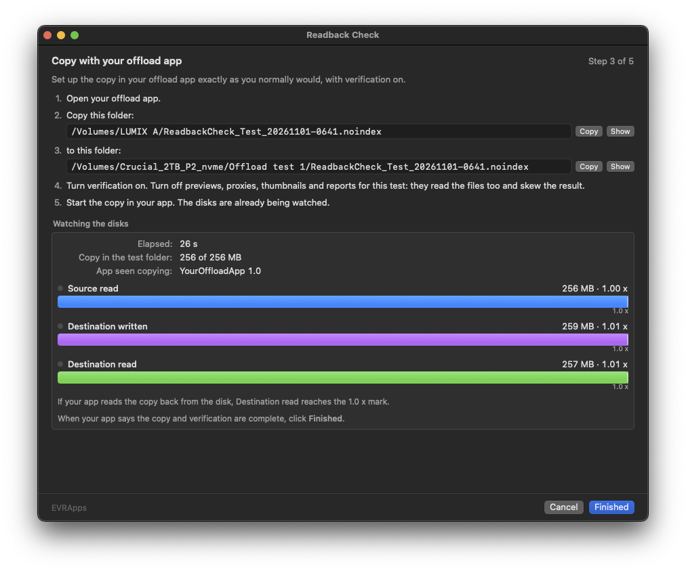
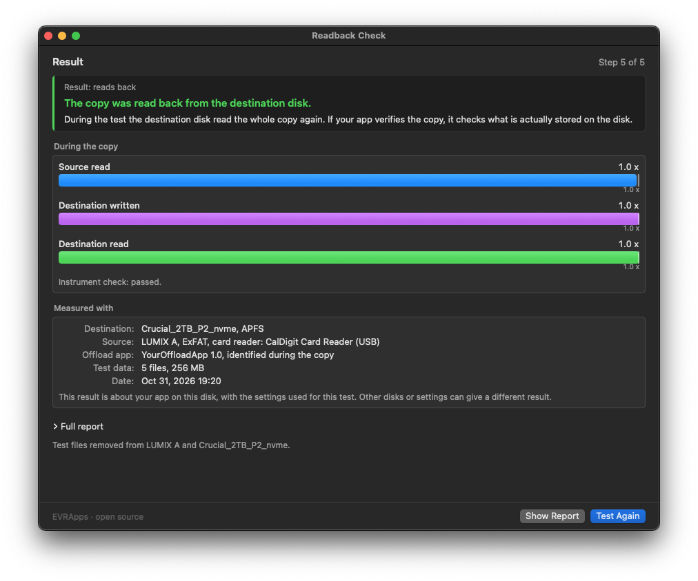

# Readback Check

by EVRApps

A free, open-source macOS app that shows whether your offload app's verification reads the copy back from the destination disk.

Requires macOS 14 or later, on Apple silicon or Intel.

  

Step 3, while a sample offload app, YourOffloadApp, copies a card to an NVMe disk. Destination read reaches 1.0 x: the copy was read back from the disk.

## Why it matters

Most of what software promises shows itself. An export at the wrong frame rate, a transcode with the wrong colours, a file that won't open: you see the problem, usually at once, and you deal with it.

Verification is different. Its whole job is to catch what you can't see, so when it works, nothing happens. And when it checks less than it seems to, nothing happens either: the same progress bar, the same "verified", the same quiet confidence. The difference shows only on the day a clip turns out to be damaged, when the card it came from has already been formatted.

There are two ways to verify a copy. Right after writing, macOS keeps the data it has just written in memory. An app that reads the copy back in the usual way can be answered from that memory: the comparison passes, but it compares the source with what was sent to the disk, not with what the disk stored. A problem on the way to the medium (a cable, an enclosure, a card reader, the disk itself) would go unnoticed. To know what is really on the disk, an app has to ask for it explicitly, past the cache. One way is faster, the other checks more. What matters is knowing which one you have.

Readback Check lets you see it, on your own disks and with your own settings. It never looks inside your app and doesn't rely on what the app or its maker says. It measures how many bytes each disk reads and writes while your app copies a folder of test files, and compares them with the size of the data. It works the same way with any app.

## Where it comes from

Readback Check grew out of a tool EVRApps used in-house to test offloads on real disks and card readers.

EVRApps also makes offload software. That is exactly why Readback Check is open source: anyone can read how it measures, run it with any app, ours included, and check the result for themselves.

It is not a ranking and it doesn't grade apps. A result describes one app, on one disk, with one set of settings, and that is all it claims.

## How a test goes

1. **Choose the disks.** A source (a spare card or disk) and a destination disk. Optionally, your offload app, so that its name and version go in the report, and how its verification is set (for example "xxHash64, source and destination"), recorded in the report as you type it. The disks are checked before anything is written.
2. **Preparing the test.** Readback Check writes 5–8 random test files on the source, sized for this Mac's free memory, checks that the destination can be measured, ejects and mounts the source again, and measures background activity.
3. **Copy with your offload app.** Copy the test folder to the folder shown, with verification on. The disks are watched from the moment the folders are shown: set up the copy, start it, and click **Finished** when your app says the copy is verified. Meanwhile Readback Check shows which app has files open in the two test folders (see below).
4. **Final check.** The copy is counted, the destination is checked again, and the test files are removed from both disks.
5. **Result.** One of:
   - **Reads back**: during the test the destination disk read the whole copy again.
   - **Does not read back**: the destination disk read nothing back. If the app verified, it did not check what is stored on the disk. The test can't tell whether an app verified at all: an app that does not verify, like the Finder, gets this result too.
   - **Can't be determined**: on this destination the test can't tell a choice of your app from how the disk works (for example, some network shares).
   - **Run it again**: the copy did not land in the test folder.

The result is about your app on that disk, with the settings used for that test.

  

Step 5, the result of the same test: the offload app was identified during the copy, the verification setting typed at step 1 is recorded, and the instrument check passed.

Readback Check refuses to run on the system disk, and when the copy starts before step 3 shows the folders. While a Time Machine backup is running, it refuses a source or destination that the backup includes or writes to, and any network destination; disks left out of Time Machine, as external disks are by default, can be tested during a backup.

### Reports

Every finished test leaves a report, named by date, app and result, for example `2026-10-31 07.33 – YourOffloadApp 1.0 – not read back.txt`, in `~/Library/Application Support/Readback Check/Reports`. **Window ▸ Past Tests** (⇧⌘R) lists them, newest first, with the app, the destination and the result, and shows the selected report. **File ▸ Show Reports in Finder** opens the folder, and **Past Tests** in the result opens the same window on that test, where **Show in Finder** reveals its file.

### Which app did the copy

During the copy, twice a second, Readback Check looks at which processes have files open in the two test folders. A helper inside an app's bundle counts as that app; the system's own processes (Spotlight, Finder, Quick Look) and Readback Check's own are left out. Only your own processes are looked at, so this needs no administrator rights or extra permissions.

The app seen copying goes in the result and in the report. If no app was chosen in step 1, it stands in for the name and version. If one was chosen and a different app was seen, the result says so. An app that opens and closes each file faster than the polling can be missed, and the report then says that no app was seen.

### How the destination is checked

Before and after the copy, Readback Check copies the test files twice on the destination with two reference copiers whose answer is known, then reads those copies back. With reference A almost nothing should reach the disk (about 0 x the data); with reference B all of it should (about 1 x). If B is not seen, the disk counters can't see re-reads on that destination and the test stops. If A reaches the disk, the cache doesn't hold the data and a read back can't be attributed to your app. When both checks pass, the result says "Instrument check: passed"; when one fails, the result is "Can't be determined", with the reason. The values of A and B are in the full report.

## Building

You need Xcode 15 or later.

    swift build
    .build/debug/ReadbackCheck

A build from the source tree runs `engine/verify_offload_app.py` from this folder with the Python 3 installed on your Mac.

The destination check uses `evr_copyhash`, a reference copier that is proprietary and not part of this repository (see [`licenses/evr_copyhash.txt`](licenses/evr_copyhash.txt)). A build from source doesn't have it, so the destination check, and with it the whole test, only works in the official signed app from EVRApps: in a build from source every test stops at that check. In the official app it is a separate program in `Contents/Helpers`, started as an external process and never linked into the code.

- `./build_app.sh` builds `build/Readback Check.app`, which only runs on the Mac that built it.
- `./build_portable.sh [path/to/evr_copyhash]` (the official build) builds `build/portable/Readback Check.app`, with its own Python 3.12 for both architectures: it needs nothing else on the target Mac. It downloads Python from [python-build-standalone](https://github.com/astral-sh/python-build-standalone) once, with the full archive of the same build for the licenses of the libraries inside Python, and checks both against the release's checksums. It needs `zstd` (`brew install zstd`) to read the full archive. The app is signed ad hoc; sign it with a Developer ID and notarize it before giving it to anyone.

### The engine on its own

    python3 -I engine/verify_offload_app.py SOURCE_FOLDER DEST_FOLDER --guided

prompts at the terminal. `--check` prints the checks as JSON; `--steps` is the protocol the app uses (JSON lines out, one command per line in).

Without `--guided` the engine measures the copy of a folder of files you already have, into a new `ReadbackCheck_probe_<YYYYMMDD-hhmm>.noindex` folder that it removes at the end. With `--run-cmd` a command does the copy in place of an app:

    python3 -I engine/verify_offload_app.py SOURCE_FOLDER DEST_FOLDER --app cp --verify-mode none \
        --extras-off --no-remount --run-cmd 'cp {src}/* {dst}/'

### Self-test

The app can run a whole test without anyone at the keyboard, with a shell command in place of the offload app:

    .build/debug/ReadbackCheck -selfTestSource "/Volumes/CARD" -selfTestDest "/Volumes/DISK" \
        -selfTestCmd 'cp {src}/* {dst}/' -selfTestQuit YES -snapshotDir /tmp/shots

`{src}` is the test data folder and `{dst}` the test folder. `-selfTestApp PATH` and `-selfTestVerify TEXT` fill in the offload app and its verification setting. `-snapshotDir` saves the window every 2 seconds, plus `selftest.json` with the result when `-selfTestQuit` is set. See `Sources/ReadbackCheck/SelfTest.swift`.

## Layout

    Sources/ReadbackCheck/   the app (SwiftUI)
    engine/                 the measurement engine (Python 3, standard library only)
    icon/                   app icon: sources and AppIcon.icns
    docs/images/            screenshots for this page
    licenses/               licenses of the components shipped in the app
    LICENSE                 GNU GPL v3
    ADDITIONAL_TERMS.md     additional terms under section 7 of the GPL v3
    CONTRIBUTING.md         how to report a problem
    build_app.sh            development app bundle
    build_portable.sh       self-contained app bundle

## Limits

The disk counters record the commands sent to the disk. If a disk answers a read from its own internal memory, the read is counted anyway.

## License

The code of Readback Check (the Swift app, the Python engine and the build scripts) is free software, released under the [GNU General Public License version 3](LICENSE) (`GPL-3.0-only`), with the [additional terms](ADDITIONAL_TERMS.md) allowed by its section 7. In short: a modified version must be marked as different from the original, must not be presented as an official release of Readback Check or of EVRApps, and must be distributed under a different name and icon.

The icon and the other brand artwork in `icon/` are not covered by the GPL: all rights reserved, see [`icon/LICENSE`](icon/LICENSE). "Readback Check", "EVRApps" and the Readback Check icon are trademarks of Antonio Marogna. If you build from source to redistribute, use a different name and icon.

`evr_copyhash` is proprietary, licensed separately and not part of this repository (see [Building](#building)).

In the app, `Contents/Resources/Licenses` holds the licenses of every third-party component: Python, python-build-standalone, xxHash, and in `Python-libraries/` the libraries built into Python (OpenSSL, SQLite, libffi, xz, bzip2, mpdecimal, libuuid, expat). In this repository, `licenses/` holds the ones for xxHash and `evr_copyhash`; the build takes the others from the Python release it ships.

## Releases

Each release is a tag of this repository, for example `v1.0.0`, and comes as a zip file, for example `ReadbackCheck-1.0.0.zip`, with the app signed and notarized inside. To install it, open the zip and move Readback Check to the Applications folder. The release notes give the SHA-256 of the zip, the commit it was built from and a link to the source of that tag.

### Is this the official build?

Download the zip only from the Releases page of this repository. Before you open it, check it against the SHA-256 in the release notes:

    shasum -a 256 ReadbackCheck-1.0.0.zip

The two values must be the same. If they differ, the file is not the official release of Readback Check: delete it.

Once the app is in the Applications folder, you can also check that macOS accepts it as signed and notarized:

    spctl -a -vv "/Applications/Readback Check.app"

The output must say `accepted` and `source=Notarized Developer ID`.

## Contributing

For now the repository accepts issues only, not code contributions: see [CONTRIBUTING.md](CONTRIBUTING.md).
